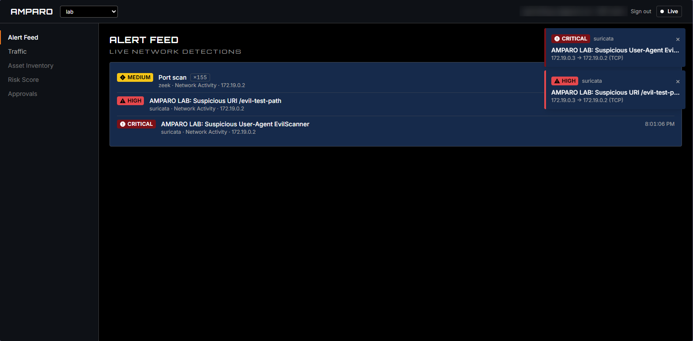
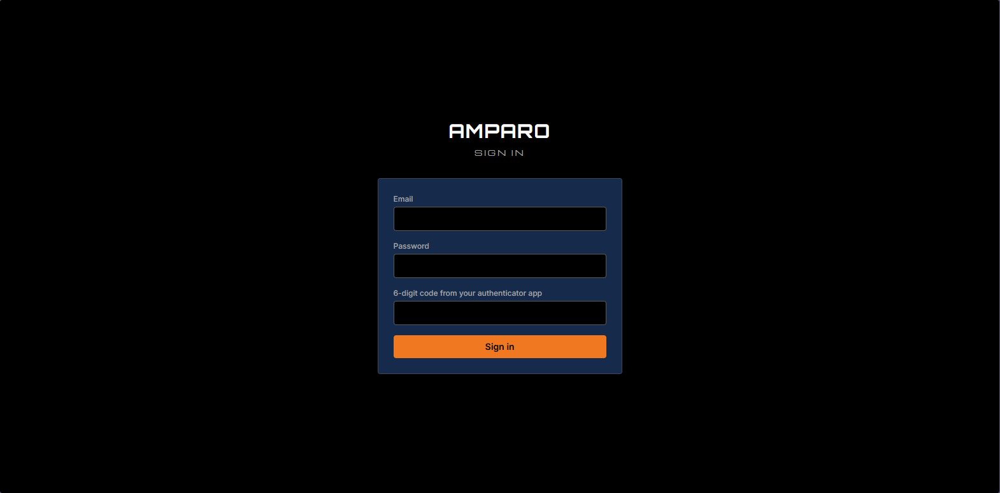
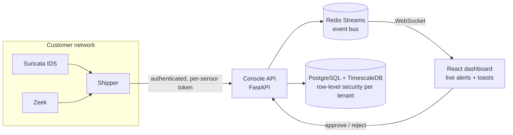

# AMPARO — AI-Assisted SOC Dashboard

**A self-hosted security operations dashboard for MSPs and IT teams.** Amparo watches network traffic, raises live alerts, and (in progress) uses AI to triage threats but **no response action ever runs without a human approving it.**

> 🔒 The source code is private because Amparo is a commercial product in development under my LLC. Code walkthroughs are available on request.

---

## What it does today

- **Live network detection.** Suricata (IDS) and Zeek (network analysis) watch traffic; alerts reach the dashboard in seconds as color-coded toasts.
- **Alert feed with severity triage.** Critical / High / Medium / Low, always shown with an icon *and* a label — never color alone.
- **Noise control.** Repeated detections are grouped (e.g. one *Port scan ×155* instead of 155 rows), and ingest is duplicate-proof if a sensor resends after a network drop.
- **Traffic visibility.** Connection records stored in a time-series database, a live host graph, and per-host drill-down.
- **Multi-tenant by design.** One MSP console serves many client organizations; each client's data is isolated at the database level.
- **Secure sign-in.** Password + authenticator-app MFA, server-side sessions, CSRF protection.

---

## Architecture

| Layer | Tech |
|---|---|
| Detection | Suricata, Zeek (run as separate, unmodified containers) |
| Backend | Python 3.12, FastAPI, Redis Streams |
| Data | PostgreSQL + TimescaleDB, row-level security |
| Frontend | React, TypeScript, Vite, Tailwind |
| Deployment | Docker Compose, fully self-hosted — customer data never leaves their network |
| Testing lab | Isolated Docker network with an attacker and target container generating safe test traffic |

---

## Security engineering

A security product has to be secure itself. Every change runs through a local CI pipeline: **pytest, ruff, bandit, Semgrep, pip-audit, npm audit, and Trivy** (both source and built container images).

### Vulnerabilities I found and fixed while building

These were caught by actually running the system and by the scanners above — several passed every unit test while being broken.

| Issue | Risk | Fix |
|---|---|---|
| App connected to Postgres as a superuser | Superusers **bypass row-level security** — tenant isolation silently did nothing | Dedicated least-privilege app role; test proves tenant A can't read tenant B |
| All containers ran as root | A compromise would get full control of the container | Non-root users in every image |
| `python-jose` JWT library had known CVEs | Token forgery / DoS exposure | Replaced, then moved to server-side sessions entirely |
| Postgres, Redis, API published on `0.0.0.0` | Database and cache reachable by anyone on the local network | Bound to `127.0.0.1` |
| Redis with no password, hardcoded DB password | Credential exposure | Secrets moved to an untracked `.env` |
| MFA secrets stored in plaintext | DB leak would expose every user's second factor | Encrypted at rest; passwords hashed with Argon2 |
| Admin bootstrap reported success without saving | Silent failure in account setup | Fixed and covered by a test |

### Design principles

- **Human-in-the-loop:** AI recommends, people decide. Every action is audit-logged.
- **Defensive only:** containment (block, isolate, quarantine) — never "hack back."
- **Privacy:** self-hosted, no analytics or tracking scripts, fonts bundled locally so it works fully offline.
- **Honest claims:** Amparo doesn't promise to stop zero-days; it shortens the time to spot unusual behavior and act on it.

---

## Roadmap

- [x] **Phase 1 — Foundation:** multi-tenant data model, auth, live alert pipeline, themed dashboard
- [x] **Phase 2 — Visibility:** Zeek, traffic graph, flow search, MFA login
- [ ] **Phase 3 — AI triage + approval queue:** AI explains each alert and proposes an action; an analyst approves or rejects
- [ ] **Phase 4 — Asset inventory + risk scoring**
- [ ] **Later modules:** vulnerability management (scanning, compensating controls, remediation validation), human-reviewed threat hunting, endpoint agent (Rust) with ransomware canaries, honeypots, WiFi IDS, cloud posture checks
- [ ] **Pre-pilot hardening:** mTLS between sensors and console

---

## About me

**Zoraida Mendoza** — Cybersecurity student (A.A.S. Cybersecurity with a specialization in Computer Engineering, Rio Salado College) based in Phoenix, AZ, with a prior career in procurement and project coordination.

I designed Amparo's architecture, security model and roadmap, and built it using AI-assisted development (Claude Code), reviewing and testing every change.

📫 *[LinkedIn](https://www.linkedin.com/in/zoraida-mendoza-0230b53b1)* · *[Email](mailto:zgmholdings.az@gmail.com)*
