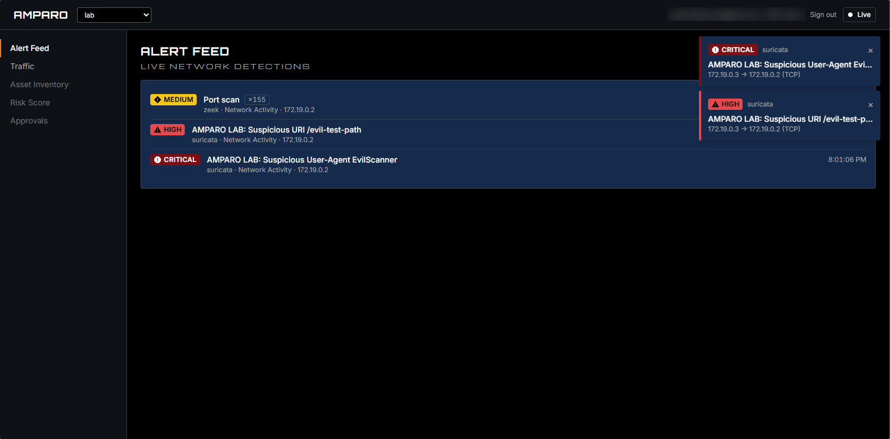
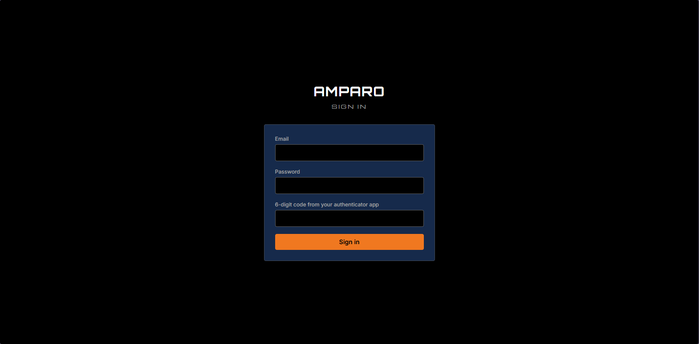
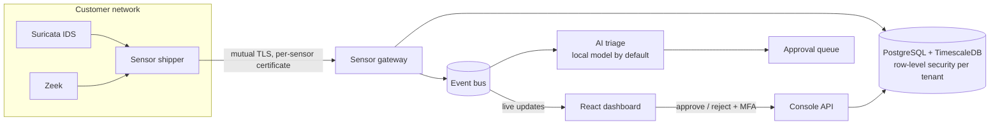

# AMPARO — AI-Assisted SOC Dashboard

**A self-hosted security operations dashboard for MSPs and IT teams.** Amparo watches network traffic, raises live alerts, uses AI to explain and triage threats, and proposes a response — but **no response action ever runs without a human approving it.**

> 🔒 The source code is private because Amparo is a commercial product in development under ZGM Holdings LLC. Code walkthroughs are available on request.

---

## What it does today

- **Live network detection.** Suricata (IDS) and Zeek (network analysis) watch traffic; alerts reach the dashboard in seconds as color-coded toasts.
- **AI triage, human decisions.** An AI model explains each incident in plain English, scores it and may propose a containment step. An analyst approves or rejects it with a fresh MFA code. The AI runs locally by default, so customer data stays on their network.
- **Approval queue.** Every proposed action shows exactly what will run, on what target, and how to undo it. High-impact actions need two different people.
- **Tamper-evident audit log.** Every alert, AI suggestion, approval and action is recorded in a hash-chained log that is regularly anchored outside the database, so edits or deletions are detected.
- **Asset inventory and risk scoring.** Devices are discovered from traffic and confirmed by a person. Each device and each client gets an explainable 0–100 risk score with a trend over time.
- **Alert feed with severity triage.** Critical / High / Medium / Low, always shown with an icon *and* a label — never color alone.
- **Noise control.** Repeated detections are grouped, and ingest is duplicate-proof.
- **Traffic visibility.** A live host graph and per-host connection drill-down.
- **Multi-tenant by design.** One MSP console serves many client organizations; each client's data is isolated at the database level.

---

## Architecture

| Layer | Tech |
|---|---|
| Detection | Suricata, Zeek (separate, unmodified containers) |
| Backend | Python, FastAPI, Redis Streams |
| AI | Local open-weight model by default; optional cloud model, off unless a client opts in |
| Data | PostgreSQL + TimescaleDB, row-level security |
| Frontend | React, TypeScript, Tailwind, behind nginx with a strict Content-Security-Policy |
| Deployment | Docker Compose, fully self-hosted, signed releases |
| Testing lab | Isolated network with attacker, target and workstation containers generating safe test traffic |

---

## Security engineering

A security product has to be secure itself. Every change runs through a local pipeline: **pytest, ruff, bandit, Semgrep, pip-audit, npm audit, Trivy** (source and built images), a production boot test, and a scan of the built dashboard for leaked secrets.

**Hardening in place:**
- Sensors authenticate with **mutual TLS** and short-lived, auto-renewing certificates; a revoked sensor is cut off immediately
- **Signed releases** that customers verify before installing
- **Encrypted backups** with a tested restore drill
- Sign-in **rate limits and lockouts**, step-up MFA for sensitive actions, Argon2 password hashing, MFA secrets encrypted at rest
- Database and cache unreachable from outside the application network, enforced by an automated test
- Strict input validation and request size limits on every endpoint
- No analytics, tracking or third-party scripts — ever

### Independent security audit (November 2026)

A separate review — code against the OWASP ASVS, an OWASP ZAP scan of a production stack, configuration review and a threat model — found **no Critical or High issues**. Tenant isolation held across **306 cross-tenant attack attempts**. All **Medium** findings have been fixed, each with a regression test; lower-severity items are being worked through now.

### Vulnerabilities found and fixed while building

| Issue | Risk | Fix |
|---|---|---|
| App connected to the database as a superuser | Superusers bypass row-level security — tenant isolation silently did nothing | Least-privilege database roles; tests prove one client can't read another's data |
| Containers ran as root | A compromise would get full control of the container | Non-root users in every image |
| Vulnerable JWT library | Token forgery / denial of service | Replaced, then moved to server-side sessions |
| Database and cache exposed on the network | Reachable by anyone on the local network | Locked to the application's internal network |
| MFA secrets stored in plaintext | A database leak would expose every user's second factor | Encrypted at rest |
| A stale approval could still be executed | An action could run against a target that had since become a trusted internal device | Targets re-checked at approval and again just before execution |
| An attacker could lock approvers out | Failed sign-ins could freeze the approval process | Separate limits for approval codes; lockouts apply only to unfamiliar locations; audited break-glass unlock |
| One person could undo a two-person action | Weakened the two-person rule | Undoing an action now needs the same approvals as the original |
| Malformed sensor data stalled a log stream | Alerts from that source could silently stop | Bad records are quarantined and raise an alert |
| Postgres reported "ready" before it was | Every customer's first install would have failed | Caught by the production boot test and fixed before release |

### Design principles

- **Human-in-the-loop:** AI recommends, people decide. Every action is audit-logged.
- **Defensive only:** containment (block, isolate, quarantine) — never "hack back."
- **Privacy:** self-hosted; customer data never leaves their network by default.
- **Honest claims:** Amparo doesn't promise to stop zero-days; it shortens the time to spot unusual behavior and act on it.

---

## Roadmap

- [x] **Phase 1 — Foundation:** multi-tenant data model, auth, live alert pipeline, themed dashboard
- [x] **Phase 2 — Visibility:** Zeek, traffic graph, flow search, MFA login
- [x] **Phase 3 — AI triage + approval queue:** AI explanations and proposals, step-up MFA approvals, hash-chained audit log
- [x] **Phase 4 — Asset inventory + risk scoring**
- [x] **Phase 5 — Pre-pilot hardening:** mutual TLS, production images, strict CSP, audit anchoring, signed releases, install guide, encrypted backups
- [ ] **Phase 6 — Independent security audit and fixes** *(in progress)*, including defenses against AI prompt injection and software supply-chain attacks
- [ ] **Phase 7 — 3D command center:** an interactive operations-room overview with a live radar and incident beacons
- [ ] **Pilot** with a managed service provider
- [ ] **Later modules:** vulnerability management, human-reviewed threat hunting, endpoint agent (Rust) with ransomware canaries, honeypots, WiFi IDS, cloud posture checks

---

## About me

**Zoraida Mendoza** — cybersecurity student (A.A.S. Cybersecurity with a specialization in Computer Engineering, Rio Salado College) based in Phoenix, AZ, with a prior career in procurement and project coordination.

I designed Amparo's architecture, security model and roadmap, and built it using AI-assisted development (Claude Code), reviewing and testing every change.

📫 *[LinkedIn](https://www.linkedin.com/in/zoraida-mendoza-0230b53b1)* · *[Email](mailto:zgmholdings.az@gmail.com)*
